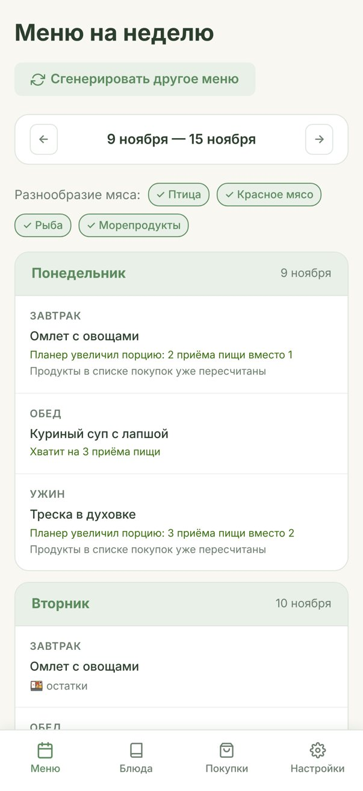
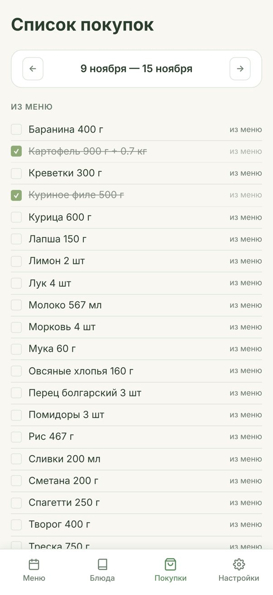
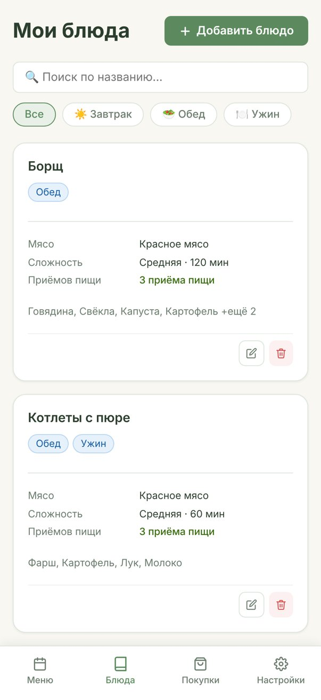

**English** · [Русский](README.ru.md)

# Meal Planner

A website that makes a weekly menu from your favourite dishes and creates a shopping list for it.

You don't need to think every day about what to cook, and you don't need to write a shopping list by hand. You add the dishes you usually cook once, and then you press one button.

<p>
  
  
  
</p>

*The screenshots use test dishes. The website is in Russian.*

## What it can do

**Dishes.** You add a dish and say:

- when you eat it: breakfast, lunch or dinner;
- the type of meat: poultry, red meat, fish, seafood or no meat;
- how difficult it is and how long it takes;
- how many meals one cooking gives you;
- the ingredients with amounts, the recipe and a link to it.

**Weekly menu.** You press one button and the menu is ready. The planner follows these rules:

- **Leftovers.** If one cooking is enough for 2–3 meals, the next days get "leftovers". You don't have to cook every day.
- **Portions that fit the week.** Sometimes the week needs a bit more or less food. Then the planner makes a dish bigger or smaller, for example 3 meals instead of 2. The menu card shows this, and the shopping list changes the amounts.
- **Variety.** The planner tries not to repeat dishes and to use poultry, meat, fish and seafood during the week.
- **Difficult dishes.** You choose in the settings how many you want per week: 1–2, 3–5 or any number.
- **Weekend dishes.** You can mark a dish as "weekend only", and the planner will cook it only on Saturday or Sunday.
- **Less food waste.** Dishes with the same ingredients go on days close to each other.
- **Free days.** You can turn off the days when you don't cook, and the planner skips them.

You can change any dish in the menu by hand. Its leftovers change too.

**Shopping list.** The planner makes it from the menu:

- the same ingredient from different dishes becomes one line;
- the amounts match the real portions;
- salt and pepper are not on the list;
- you can add your own items, like bread or coffee;
- the list is the same on all your devices: if you tick an item on one phone, you see it on the other phone at once.

## How it works

The project has three parts:

1. **The website** — what you see: pages, buttons and forms. It is written in JavaScript (with the React library).
2. **The database** — the Supabase service. It keeps accounts, dishes, menus and shopping lists. Every user sees only their own data.
3. **The "calculator" in Python** — a separate part that makes the menu and the shopping list with the rules above. The website sends it the dishes, and it sends back the result. The calculator does not save anything and does not use the database.

The website and the calculator run on Vercel hosting.

At first, the whole project was in JavaScript. Later, the "smart" part (the menu and the shopping list) moved to Python. Automatic checks (tests) make sure nothing broke:

- the Python version gives exactly the same menus and shopping lists as the old JavaScript version, on hundreds of different sets of dishes;
- the rules work on thousands of random weeks: leftovers always come after the cooking day, weekend dishes are on weekends, and the number of difficult dishes is in the chosen range;
- the shopping list adds up and changes the amounts correctly.

## How I made this project

This is pure vibe coding: all the code was written with Claude Code. I did not write code myself. I described what I wanted, checked the result and decided how the product should work.

What I did myself:

- I came up with the idea and the rules for making the menu;
- I decided how the features work: for example, the number of difficult dishes is a range "from – to", and the settings are saved with a button;
- I tested the website with my own dishes and found problems: for example, the shopping list did not appear when I made a menu in the middle of the week;
- I chose the texts and the design of the home page.

## For developers

Run it on your computer:

```bash
npm install
python3 dev_api.py   # the calculator on http://localhost:8000
npm run dev          # the website; /api requests go to the calculator
```

Calculator tests (you only need Python, no extra libraries):

```bash
python3 -m unittest discover -s tests -t .
```

| Folder or file | What is inside |
|---|---|
| `src/` | the website (React + Vite) |
| `planner/` | the calculator logic in Python |
| `api/` | calculator endpoints on Vercel: `POST /api/menu`, `POST /api/shopping` |
| `tests/` | calculator tests |
| `supabase_schema.sql` | database schema for a new Supabase project |
| `migration_column_fix.sql` | update for an existing database |
