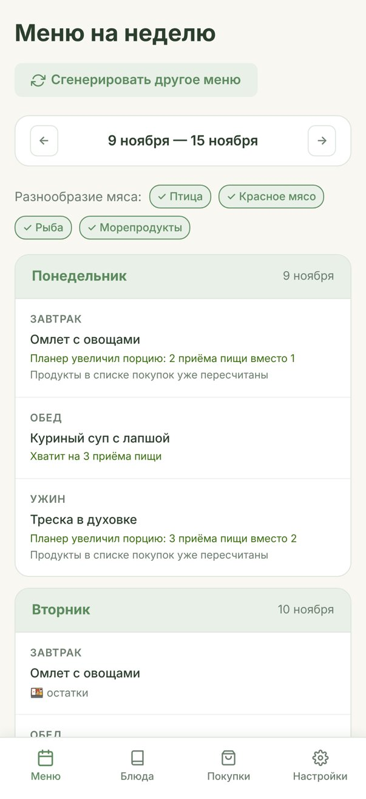
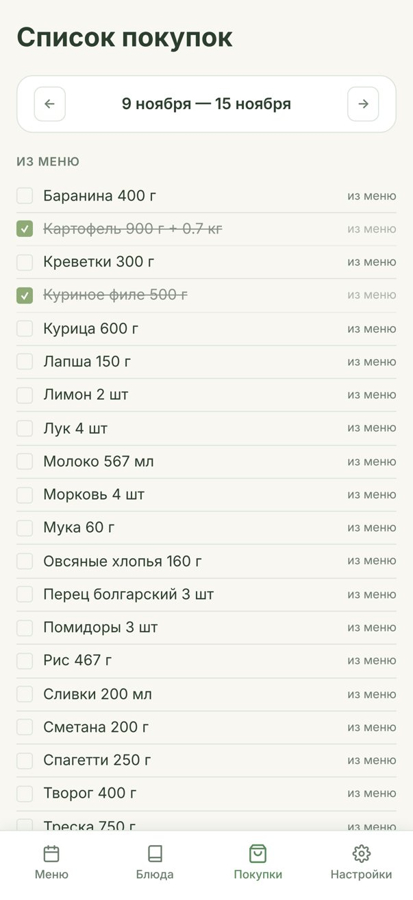
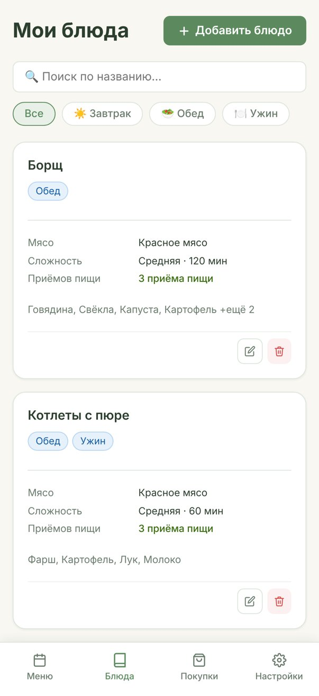

[English](README.md) · **Русский**

# Планировщик меню

Сайт, который сам составляет меню на неделю из ваших любимых блюд и собирает по нему список покупок.

Больше не нужно каждый день придумывать, что приготовить, и вручную выписывать продукты. Вы один раз добавляете блюда, которые готовите, а дальше нажимаете одну кнопку.

<p>
  
  
  
</p>

*Скриншоты сделаны на тестовых блюдах.*

## Что умеет

**Блюда.** Вы добавляете блюдо и указываете:

- для чего оно: завтрак, обед или ужин;
- тип мяса: птица, красное мясо, рыба, морепродукты или без мяса;
- сложность и время приготовления;
- на сколько приёмов пищи хватает одной готовки;
- ингредиенты с количеством, рецепт и ссылку на него.

**Меню на неделю.** Одна кнопка — и меню готово. Планировщик соблюдает правила:

- **Остатки.** Если блюда хватает на 2–3 раза, оно стоит в меню на следующие дни как «остатки». Готовить каждый день не нужно.
- **Порции под неделю.** Если для ровной недели нужно чуть больше или меньше еды, планировщик растягивает или сжимает блюдо: например, готовит на 3 приёма пищи вместо 2. На карточке это написано, а продукты в списке покупок пересчитываются.
- **Разнообразие.** Блюда стараются не повторяться, а за неделю встречаются птица, мясо, рыба и морепродукты.
- **Сложные блюда.** Сколько их будет в неделю, вы выбираете в настройках: 1–2, 3–5 или сколько угодно.
- **Блюда «на выходные».** Их можно отметить, и они будут готовиться только в субботу или воскресенье.
- **Меньше испорченных продуктов.** Блюда с общими продуктами ставятся в соседние дни.
- **Свободные дни.** Можно выключить дни, когда вы не готовите, — планировщик их пропустит.

Любое блюдо в меню можно заменить вручную, остатки поменяются вместе с ним.

**Список покупок.** Собирается из меню сам:

- одинаковые продукты из разных блюд складываются в одну строку;
- количество пересчитывается под реальные порции;
- соль и перец в список не попадают;
- можно дописать свои пункты: хлеб, кофе и так далее;
- список общий для всех устройств в аккаунте: отметили «купила» на одном телефоне — сразу видно на другом.

## Как это устроено

Проект состоит из трёх частей:

1. **Сайт** — то, что вы видите: страницы, кнопки, формы. Написан на JavaScript (библиотека React).
2. **База данных** — сервис Supabase. Там хранятся аккаунты, блюда, меню и списки покупок. Каждый пользователь видит только свои данные.
3. **«Калькулятор» на Python** — отдельный модуль, который составляет меню и список покупок по правилам выше. Сайт отправляет ему блюда, он считает и возвращает результат. Сам калькулятор ничего не хранит и в базу не ходит.

Сайт и калькулятор работают на хостинге Vercel.

Сначала весь проект был на JavaScript. Потом «умную» часть (составление меню и список покупок) перенесли на Python. Чтобы при переносе ничего не сломалось, есть автоматические проверки (тесты):

- Python-версия даёт точно такие же меню и списки покупок, как старая JavaScript-версия, на сотнях разных наборов блюд;
- правила соблюдаются на тысячах случайно составленных недель: остатки всегда идут после дня готовки, блюда «на выходные» стоят в выходные, число сложных блюд — в выбранных пределах;
- список покупок правильно складывает и пересчитывает продукты.

## Как я делала этот проект

Это чистый вайбкодинг: весь код написан через Claude Code. Я не писала код руками — я описывала, что хочу получить, проверяла результат и решала, как должен работать продукт.

Что я делала сама:

- придумала идею и правила, по которым составляется меню;
- решала, как ведут себя функции: например, что сложные блюда задаются диапазоном «от и до», а настройки сохраняются по кнопке;
- проверяла сайт на своих блюдах и находила проблемы: например, что список покупок не появлялся, если меню составлено посреди недели;
- выбирала тексты и дизайн главной страницы.

## Для разработчиков

Запуск на своём компьютере:

```bash
npm install
python3 dev_api.py   # калькулятор на http://localhost:8000
npm run dev          # сайт; запросы /api уходят в калькулятор
```

Тесты калькулятора (нужен только Python, без дополнительных библиотек):

```bash
python3 -m unittest discover -s tests -t .
```

| Папка или файл | Что там |
|---|---|
| `src/` | сайт (React + Vite) |
| `planner/` | логика калькулятора на Python |
| `api/` | адреса калькулятора на Vercel: `POST /api/menu`, `POST /api/shopping` |
| `tests/` | тесты калькулятора |
| `supabase_schema.sql` | схема базы для нового проекта Supabase |
| `migration_column_fix.sql` | обновление уже существующей базы |
